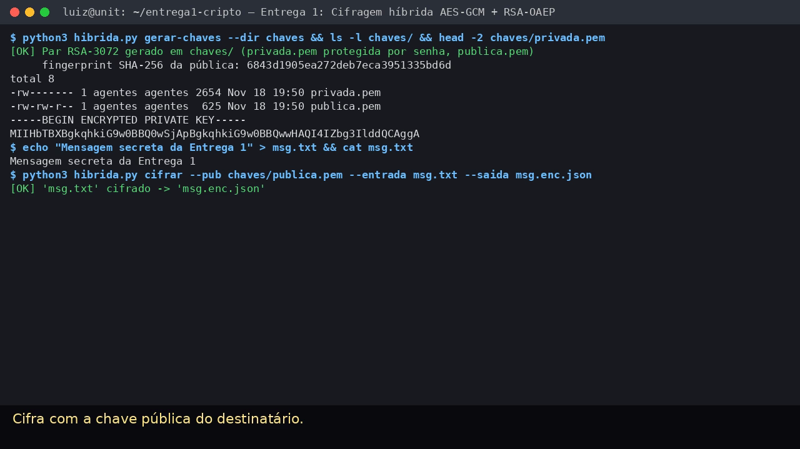
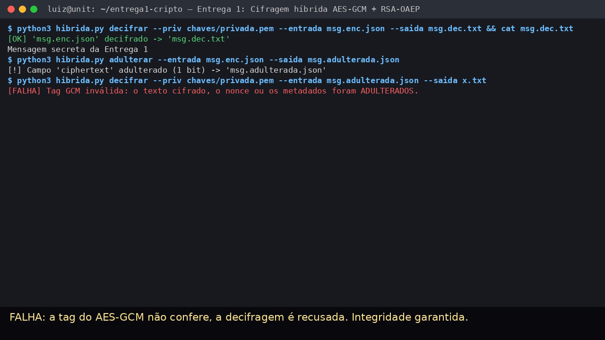
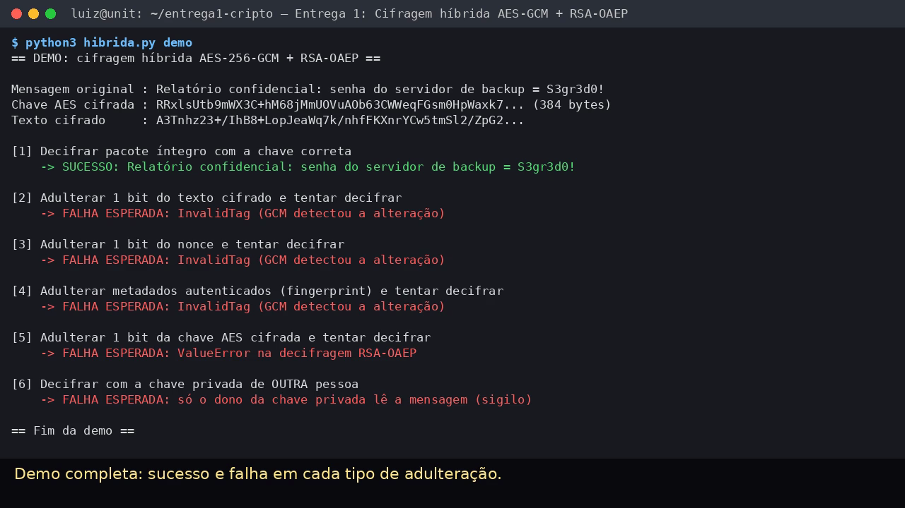
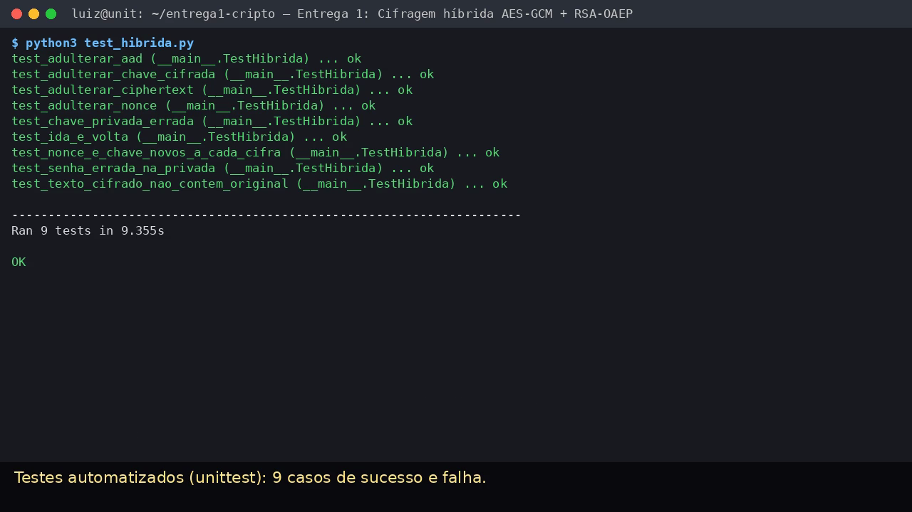

# Entrega 1 — Criptografia assimétrica: cifragem híbrida (AES-256-GCM + RSA-OAEP)

**Disciplina:** Segurança da Informação — Projeto Integrador "Segurança aplicada ao desenvolvimento"
**Professora:** Ana Carla do Nascimento Santos
**Aluno:** Luiz Gustavo Moura Santos — UNIT
**Linguagem:** Python 3.10+ com a biblioteca [`cryptography`](https://cryptography.io) (pyca)

## 1. Problema

Enviar uma mensagem/arquivo de forma que **só o destinatário consiga ler** (sigilo) e que **qualquer alteração no caminho seja detectada** (integridade), sem precisar combinar uma senha secreta antes.

Criptografia simétrica (AES) é rápida, mas exige que as duas partes já compartilhem a mesma chave. Criptografia assimétrica (RSA) resolve a distribuição de chaves, mas é lenta e só cifra poucos bytes (no RSA-3072 com OAEP-SHA256, no máximo 318 bytes). A **cifragem híbrida** combina as duas:

```
Remetente                                            Destinatário
---------                                            ------------
k  = chave AES-256 aleatória (chave de sessão)
n  = nonce aleatório de 96 bits
C  = AES-GCM(k, n, mensagem, AAD)   ──────────►      k = RSA-OAEP-Decrypt(chave_privada, K)
K  = RSA-OAEP-Encrypt(chave_pública, k) ─────►       mensagem = AES-GCM-Decrypt(k, n, C, AAD)
                                                     (falha se C, n ou AAD forem alterados)
```

## 2. Ambiente

- Python 3.10+ (testado com Python 3.10.12, Linux)
- `cryptography` (biblioteca consolidada, mantida pela PyCA, usa OpenSSL por baixo). **Nenhum algoritmo foi implementado "na mão".**

```bash
python -m venv .venv
source .venv/bin/activate          # Windows: .venv\Scripts\activate
pip install -r requirements.txt
```

## 3. Algoritmos e parâmetros

| Componente | Escolha | Justificativa |
|---|---|---|
| Par de chaves | RSA-3072, expoente 65537 | ~128 bits de segurança (NIST SP 800-57), compatível com AES-256 na prática |
| Proteção da privada | PKCS#8 cifrado com senha (`BestAvailableEncryption`), arquivo com permissão 600 | A chave privada nunca fica em texto claro no disco |
| Cifra da chave de sessão | RSA-OAEP com SHA-256 e MGF1-SHA256 | Padding probabilístico e seguro; o PKCS#1 v1.5 é vulnerável a ataques de oráculo (Bleichenbacher) |
| Cifra dos dados | AES-256-GCM | Cifra autenticada (AEAD): dá sigilo **e** integridade (tag de 128 bits) |
| Nonce | 12 bytes de `os.urandom`, novo a cada cifra | Nunca reutilizar nonce com a mesma chave no GCM |
| AAD (dados associados) | `versão + fingerprint da chave pública` | Metadados ficam em claro mas autenticados: trocar qualquer um faz a tag falhar |

## 4. Implementação

Arquivo principal: [`hibrida.py`](hibrida.py)

| Função | O que faz |
|---|---|
| `gerar_par(senha)` | Gera RSA-3072 e exporta `privada.pem` (cifrada) e `publica.pem` |
| `cifrar(msg, pub)` | Gera chave AES + nonce, cifra com AES-GCM, cifra a chave AES com RSA-OAEP, devolve pacote JSON |
| `decifrar(pacote, priv)` | Recupera a chave AES com a privada e decifra/verifica com AES-GCM |
| `adulterar(pacote, campo)` | Inverte 1 bit de um campo, para testar a detecção de adulteração |

Formato do pacote (`.enc.json`):

```json
{
  "versao": "hibrida-v1",
  "alg": "RSA-OAEP-SHA256 + AES-256-GCM",
  "destinatario_fp": "<SHA-256 da chave pública, 32 hex>",
  "chave_cifrada": "<base64, 384 bytes>",
  "nonce": "<base64, 12 bytes>",
  "ciphertext": "<base64, texto cifrado + tag GCM de 16 bytes>"
}
```

### Como usar

```bash
# 1. Gerar o par de chaves (pede uma senha para proteger a privada)
python hibrida.py gerar-chaves --dir chaves

# 2. Cifrar um arquivo com a chave PÚBLICA
echo "Mensagem secreta da Entrega 1" > msg.txt
python hibrida.py cifrar --pub chaves/publica.pem --entrada msg.txt --saida msg.enc.json

# 3. Decifrar com a chave PRIVADA (sucesso)
python hibrida.py decifrar --priv chaves/privada.pem --entrada msg.enc.json --saida msg.dec.txt

# 4. Adulterar 1 bit e tentar decifrar (falha)
python hibrida.py adulterar --entrada msg.enc.json --saida msg.adulterada.json --campo ciphertext
python hibrida.py decifrar --priv chaves/privada.pem --entrada msg.adulterada.json --saida x.txt

# Demo completa (todos os cenários de uma vez)
python hibrida.py demo
```

## 5. Testes e evidências

Testes automatizados (`python test_hibrida.py`):

| # | Teste | Resultado esperado | Resultado |
|---|---|---|---|
| 1 | Cifrar e decifrar com a chave certa | Mensagem idêntica à original | ✅ OK |
| 2 | Texto cifrado não contém o texto original | Não contém | ✅ OK |
| 3 | Duas cifras da mesma mensagem | Nonce e ciphertext diferentes | ✅ OK |
| 4 | Adulterar 1 bit do ciphertext | `InvalidTag` | ✅ OK |
| 5 | Adulterar 1 bit do nonce | `InvalidTag` | ✅ OK |
| 6 | Adulterar o AAD (fingerprint) | `InvalidTag` | ✅ OK |
| 7 | Adulterar 1 bit da chave AES cifrada | `ValueError` (RSA-OAEP) | ✅ OK |
| 8 | Decifrar com a chave privada de outra pessoa | `ValueError` | ✅ OK |
| 9 | Abrir a chave privada com senha errada | Erro | ✅ OK |

```
Ran 9 tests in 8.433s
OK
```

Saída da demo (`python hibrida.py demo`):

```
[1] Decifrar pacote íntegro com a chave correta
    -> SUCESSO: Relatório confidencial: senha do servidor de backup = S3gr3d0!
[2] Adulterar 1 bit do texto cifrado e tentar decifrar
    -> FALHA ESPERADA: InvalidTag (GCM detectou a alteração)
[3] Adulterar 1 bit do nonce e tentar decifrar
    -> FALHA ESPERADA: InvalidTag (GCM detectou a alteração)
[4] Adulterar metadados autenticados (fingerprint) e tentar decifrar
    -> FALHA ESPERADA: InvalidTag (GCM detectou a alteração)
[5] Adulterar 1 bit da chave AES cifrada e tentar decifrar
    -> FALHA ESPERADA: ValueError na decifragem RSA-OAEP
[6] Decifrar com a chave privada de OUTRA pessoa
    -> FALHA ESPERADA: só o dono da chave privada lê a mensagem (sigilo)
```

### Prints da execução

Arquivos na pasta [`evidencias/`](evidencias/); as saídas em texto estão em `01_testes.txt` e `02_demo.txt`.

**1. Geração do par de chaves e cifragem** (o pacote JSON gerado é ilegível):



**2. Decifragem com sucesso e falha após adulterar 1 bit** (`InvalidTag`):



**3. Demo completa** (pacote íntegro e todas as adulterações):



**4. Testes automatizados** (9 testes, `OK`):



## 6. Sigilo × autenticidade

- **Sigilo (confidencialidade)** garante que só quem deve consiga **ler**. Aqui vem do RSA-OAEP: qualquer pessoa cifra com a chave pública, mas só o dono da chave privada recupera a chave AES e, com ela, a mensagem (teste 8).
- **Integridade** garante que a mensagem **não foi alterada**. Aqui vem da tag do AES-GCM: mudar 1 bit no texto cifrado, no nonce ou no AAD faz a decifragem ser recusada (testes 4 a 6).
- **Autenticidade de origem** garante **quem enviou**. A cifragem híbrida **não** garante isso: como a chave pública é pública, *qualquer pessoa* pode montar um pacote válido para o destinatário. O GCM prova que o pacote não mudou depois de criado, mas não prova quem o criou.
- Para ter autenticidade de origem (e não repúdio), o remetente precisa **assinar** o pacote com a **chave privada dele** (por exemplo, Ed25519 ou RSA-PSS), e o destinatário verifica com a chave pública do remetente. Ou seja: **cifra com a pública do destinatário → sigilo; assina com a privada do remetente → autenticidade.**

## 7. Certificados e PKI

O sistema só é seguro se a chave pública usada para cifrar for **realmente** do destinatário. Se um atacante trocar `publica.pem` pela dele (ataque *man-in-the-middle*), ele lê tudo. Por isso existe a **PKI (Infraestrutura de Chaves Públicas)**:

- Um **certificado digital X.509** liga uma chave pública a uma identidade (nome, domínio, CPF/CNPJ) e tem validade, uso permitido e a **assinatura de uma Autoridade Certificadora (AC)**.
- A **AC** verifica a identidade antes de emitir. Quem confia na AC raiz confia nos certificados que ela (ou ACs intermediárias) assinou: é a **cadeia de confiança**.
- Certificados comprometidos são revogados por **CRL** ou **OCSP**.
- Exemplos: HTTPS/TLS (o navegador valida o certificado do site), e-mail S/MIME e a **ICP-Brasil** (e-CPF/e-CNPJ, assinatura com validade jurídica).
- Neste projeto a confiança é manual: o fingerprint SHA-256 da chave pública é exibido e deve ser conferido por um canal confiável. Em produção, a chave viria dentro de um certificado assinado por uma AC.

## 8. Riscos e limitações

- **Sem autenticidade de origem**: ver seção 6. Melhoria: assinar o pacote (*sign-then-encrypt*).
- **Chave pública não autenticada**: ver seção 7. Melhoria: certificado X.509 ou conferir o fingerprint.
- **Senha fraca na chave privada** compromete tudo. Usar senha forte e, idealmente, guardar a chave em HSM/token.
- **Mensagem inteira em memória**: para arquivos muito grandes seria preciso cifrar em blocos (streaming).
- **Reutilização de nonce** no GCM é catastrófica. Aqui o nonce é sempre aleatório e a chave AES é nova a cada mensagem, o que elimina esse risco.
- O GCM revela o **tamanho** aproximado da mensagem.

## 9. Referências

- PYCA. *cryptography documentation*. Disponível em: https://cryptography.io. Acesso em: nov. 2026.
- NIST. *SP 800-38D: Recommendation for Block Cipher Modes of Operation: Galois/Counter Mode (GCM) and GMAC*. 2007.
- NIST. *SP 800-57 Part 1 Rev. 5: Recommendation for Key Management*. 2020.
- MORIARTY, K. et al. *RFC 8017: PKCS #1: RSA Cryptography Specifications Version 2.2*. IETF, 2016.
- COOPER, D. et al. *RFC 5280: Internet X.509 Public Key Infrastructure Certificate and CRL Profile*. IETF, 2008.
- STALLINGS, W. *Criptografia e segurança de redes: princípios e práticas*. 6. ed. São Paulo: Pearson, 2015.
- ABNT. *NBR ISO/IEC 27001: Segurança da informação, segurança cibernética e proteção à privacidade*. Rio de Janeiro, 2022.
